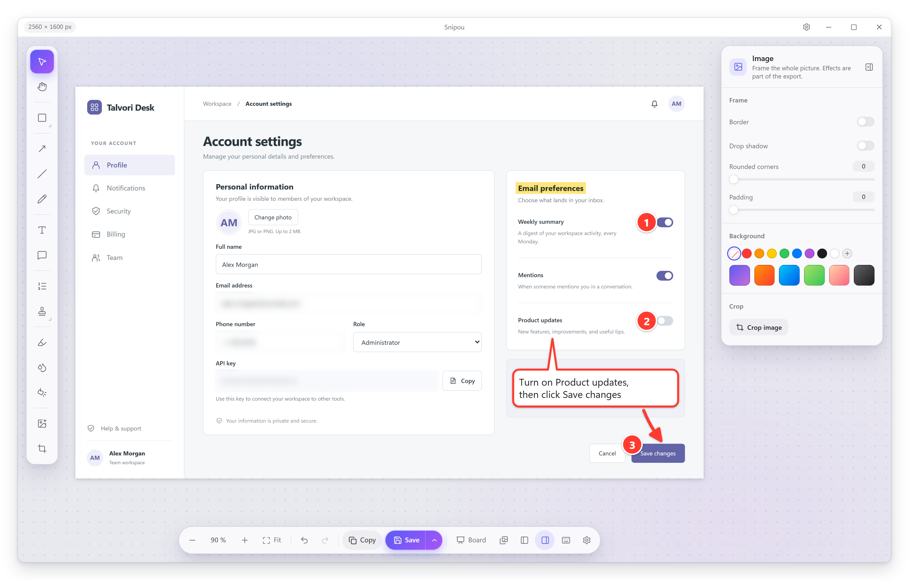
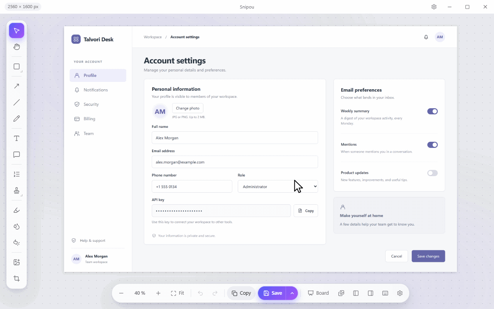
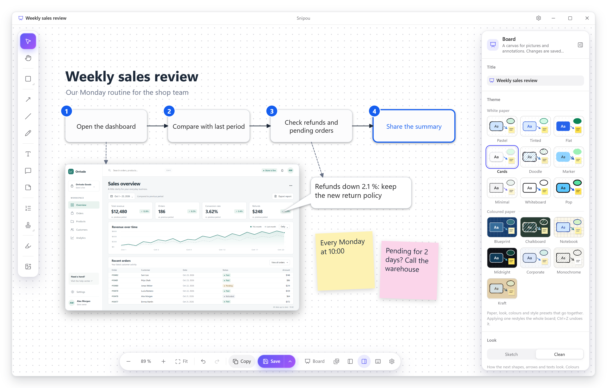
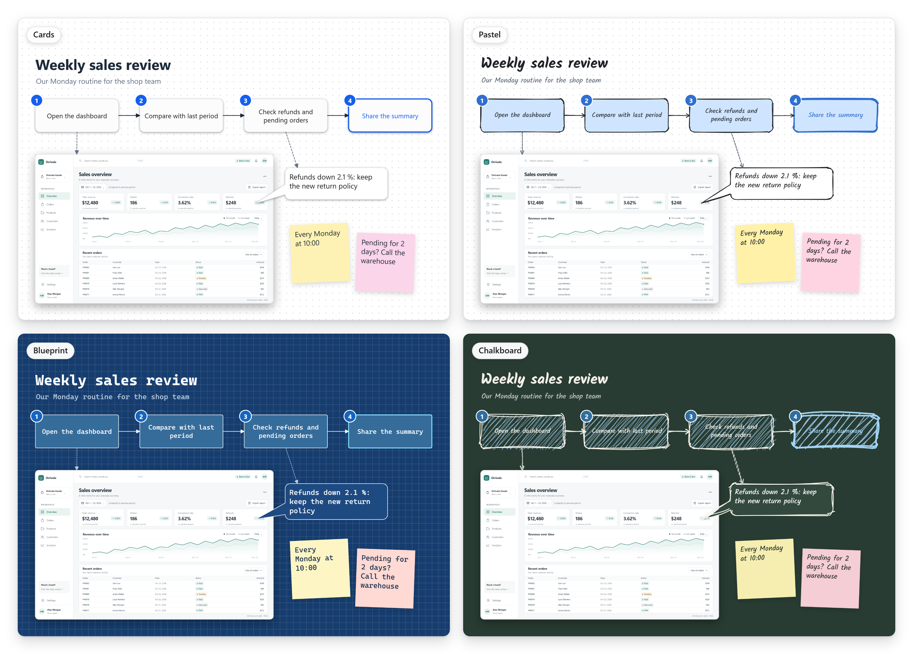

# Snipou

Free, lightweight screenshot and whiteboard app for Windows. One hotkey, a precise capture, a
clean annotation editor, and the result is already in your clipboard.



## Download

[](https://apps.microsoft.com/detail/9MZSSPHWZ8BL)

- **[Microsoft Store](https://apps.microsoft.com/detail/9MZSSPHWZ8BL)**: the simplest way;
  Windows installs it and keeps it up to date.
- **[Installer](https://github.com/arnaudgastelblum/snipou-releases/releases/latest/download/snipou-setup.exe)**:
  installs for the current user, no administrator rights needed.
- **[Portable](https://github.com/arnaudgastelblum/snipou-releases/releases/latest/download/snipou-portable.zip)**:
  unzip it anywhere and run `snipou.exe`, no installation needed.

Every version, with its notes and checksums, is on the [Releases](https://github.com/arnaudgastelblum/snipou-releases/releases) page.

Requirements: Windows 10 or 11 (64-bit) with the Microsoft Edge WebView2 runtime, which ships
with Windows 11 and recent Windows 10 updates (the installer adds it when it is missing).

## Features

- **Capture**: region, window, full screen, scrolling and repeat last region, on a frozen screen.
  Windows, menus and parts of a window (toolbars, panels, lists) are detected under the pointer.
  The default hotkey is `Ctrl+Shift+C`.
- **Clipboard first**: the capture is copied as an image and as a file, ready to paste into a
  document, a chat or a folder.
- **Annotate**: arrows, shapes, text, callouts, highlighter, numbered steps, blur, spotlight,
  crop, pen, stamps and image effects.
- **Boards**: an infinite canvas to explain with shapes, arrows, sticky notes and pictures, with
  board themes, a clean or hand-drawn look and alignment guides.
- **Library**: recent captures and boards, one click away.
- **Languages**: English, French, Spanish, Dutch and German.
- **Private**: no account, no telemetry, no network calls. Everything stays on your computer.







## First launch

The installer and portable builds are not code-signed yet, so Windows may show "Windows protected your PC" the first time.
Click **More info**, then **Run anyway**.

To check a download, compare its SHA-256 with `SHA256SUMS.txt` in the release:

```powershell
Get-FileHash .\snipou-setup.exe -Algorithm SHA256
```

## Updates

The Store edition is updated by Windows. The installer and portable builds never check for
updates by themselves: new versions are published on the
[Releases](https://github.com/arnaudgastelblum/snipou-releases/releases) page; on GitHub,
**Watch → Custom → Releases** notifies you of them.

## Licence

Snipou is free to use, for personal and professional purposes. It is closed source; all rights
reserved. See [LICENSE](LICENSE). It includes open-source components, listed with their licences
in [THIRD-PARTY-NOTICES.txt](THIRD-PARTY-NOTICES.txt).
